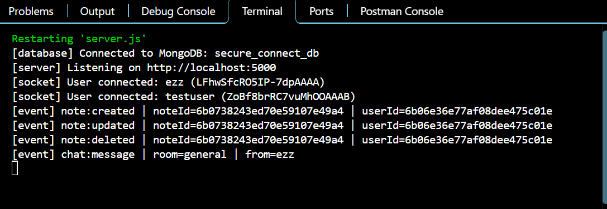
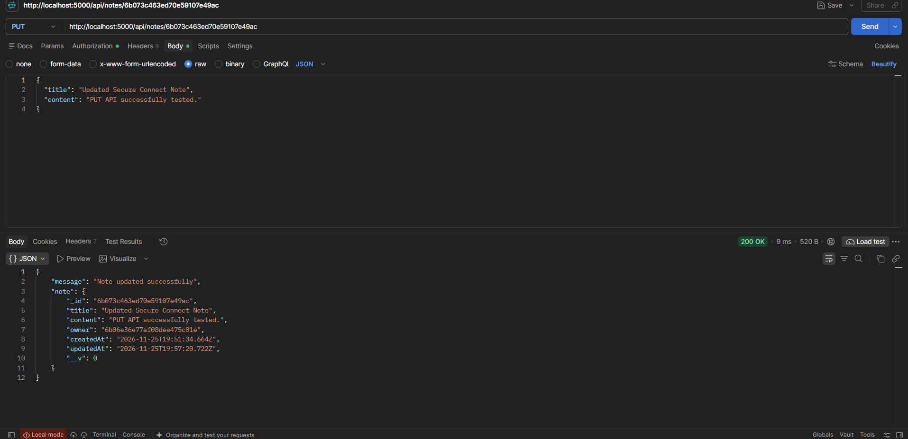

# Secure Connect and Communication Platform

**Lab 4 | Web Dev III | Unit 4**

A secure backend application built using Node.js, Express.js, MongoDB, bcrypt, JWT, dotenv, and Socket.IO.

The platform supports secure user authentication, role-based access control, private notes management, real-time communication, and event-driven server logging.

## Features

- User registration with bcrypt password hashing (12 salt rounds).
- Secure login using JSON Web Tokens (JWT).
- Protected `/api/auth/me` endpoint.
- Role-Based Access Control (RBAC) for admin-only resources.
- Private Notes CRUD operations.
- Notes access restricted to authenticated owners.
- JWT-authenticated real-time chat using Socket.IO.
- Chat rooms and real-time message broadcasting.
- Node.js EventEmitter for event-driven logging.
- Environment-based configuration using dotenv.
- MongoDB database integration.

## Tech Stack

| Technology | Purpose |
|---|---|
| Node.js | Backend runtime |
| Express.js | REST API framework |
| MongoDB | Database |
| Mongoose | MongoDB object modelling |
| bcrypt | Password hashing |
| JWT | Authentication |
| Socket.IO | Real-time communication |
| EventEmitter | Event-driven architecture |
| dotenv | Environment configuration |
| Postman | API testing |

## Project Structure

```text
secure-connect-platform/
│
├── config/
│   └── db.js
│
├── middleware/
│   └── auth.js
│
├── models/
│   ├── User.js
│   └── Note.js
│
├── postman/
│   └── Secure-Connect.postman_collection.json
│
├── public/
│   └── chat.html
│
├── routes/
│   ├── auth.js
│   └── notes.js
│
├── screenshots/
│
├── socket/
│   └── chat.js
│
├── utils/
│   └── eventBus.js
│
├── .env.example
├── .gitignore
├── package.json
├── package-lock.json
├── README.md
└── server.js
```

## Requirements

- Node.js 18 or later
- MongoDB local installation or MongoDB Atlas
- Postman
- Git

## Installation and Setup

### 1. Clone the repository

```bash
git clone YOUR_GITHUB_REPOSITORY_URL
```

### 2. Navigate to the project directory

```bash
cd secure-connect-platform
```

### 3. Install dependencies

```bash
npm install
```

### 4. Configure environment variables

Create a `.env` file using the example configuration:

```powershell
Copy-Item .env.example .env
```

Configure the following variables in `.env`:

```env
PORT=5000
MONGO_URI=your_mongodb_connection_string
JWT_SECRET=your_long_random_secret
```

Use your own MongoDB connection string and a strong random JWT secret.

### 5. Start the server

```bash
npm run dev
```

The server will run at:

`http://localhost:5000`

## REST API Documentation

All request bodies should use `Content-Type: application/json`.

| Method | Endpoint | Authentication | Description |
|---|---|---|---|
| GET | `/` | Not required | API welcome message |
| GET | `/api/health` | Not required | Health check |
| POST | `/api/auth/signup` | Not required | Register a user |
| POST | `/api/auth/login` | Not required | User login |
| GET | `/api/auth/me` | Bearer JWT | Get current user |
| GET | `/api/auth/admin` | Admin JWT | Admin-only resource |
| POST | `/api/notes` | Bearer JWT | Create a note |
| GET | `/api/notes` | Bearer JWT | Get all own notes |
| GET | `/api/notes/:id` | Bearer JWT | Get a specific note |
| PUT | `/api/notes/:id` | Bearer JWT | Update a note |
| DELETE | `/api/notes/:id` | Bearer JWT | Delete a note |

## Example API Requests

### User Registration

**POST** `/api/auth/signup`

```json
{
  "username": "victor",
  "email": "victor@example.com",
  "password": "StrongPass123"
}
```

### User Login

**POST** `/api/auth/login`

```json
{
  "email": "victor@example.com",
  "password": "StrongPass123"
}
```

### Create a Note

**POST** `/api/notes`

```json
{
  "title": "My First Note",
  "content": "This is my first secure note."
}
```

### Authentication Header

Protected endpoints require the following header:

```text
Authorization: Bearer YOUR_JWT_TOKEN
```

## Role-Based Access Control (RBAC)

The application includes an admin-only protected endpoint.

Newly registered users receive the `user` role by default.

To test admin access:

1. Locate the test user in MongoDB.
2. Change the user's `role` field to `admin`.
3. Log in again to receive a new JWT.
4. Access the admin-only endpoint using the new token.

User roles are managed on the server and cannot be selected during registration.

## Real-Time Chat Using Socket.IO

The application implements real-time communication using Socket.IO.

Clients connect to the server using a valid JWT token.

### Client Connection Example

```javascript
const socket = io('http://localhost:5000', {
  auth: {
    token: 'YOUR_JWT_TOKEN'
  }
});
```

### Join a Chat Room

```javascript
socket.emit('chat:join', 'general', (result) => {
  console.log(result);
});
```

### Send a Message

```javascript
socket.emit('chat:message', {
  room: 'general',
  message: 'Hello from Secure Connect!'
});
```

### Receive Messages

```javascript
socket.on('chat:message', (message) => {
  console.log(message);
});
```

### Socket Events

| Event | Description |
|---|---|
| `chat:join` | Join a chat room |
| `chat:system` | Receive room notifications |
| `chat:message` | Send and receive chat messages |
| `disconnect` | Handle socket disconnection |

The Socket.IO middleware verifies JWT authentication before allowing a connection. Users must join a room before sending messages to it.

## Event-Driven Architecture

The application uses Node.js's built-in `EventEmitter` through:

`utils/eventBus.js`

It handles the following events:

| Event | Description |
|---|---|
| `user:registered` | User registration |
| `user:login` | User login |
| `note:created` | Note creation |
| `note:updated` | Note modification |
| `note:deleted` | Note deletion |
| `chat:message` | Chat message activity |

These events generate server-side console logs to monitor application activities.

## Postman Testing

The project includes a Postman collection:

`postman/Secure-Connect.postman_collection.json`

Import the collection into Postman to test the API endpoints.

The collection supports:

- User registration and login.
- JWT authentication.
- Protected route testing.
- Positive and negative authentication tests.
- Notes CRUD operations.
- API response verification.

The login request automatically stores the JWT in the collection variable `token`.

## Screenshots

### Event-Driven Logging



### API Testing

#### 1. Create Note


#### 2. Get All Notes


#### 3. Update Note



#### 4. Delete Note


### API Testing

#### 1. Create Note


#### 2. Get All Notes


#### 3. Update Note


#### 4. Delete Note


### Event-Driven Logging


*Additional screenshots covering authentication, authorization, and real-time chat are included in the screenshots folder.*

## Security Considerations

- Passwords are hashed before being stored in MongoDB.
- JWT authentication protects private resources.
- Notes are restricted to their respective owners.
- Admin permissions are verified on the server.
- Environment secrets are excluded from version control.
- Socket.IO connections require valid authentication tokens.

For production deployment, additional measures such as HTTPS, rate limiting, stricter CORS policies, input validation, and secret rotation are recommended.

## Author

**Secure Connect and Communication Platform**

Developed as part of Web Dev III, Lab 4, Unit 4.

---

**Note:** Never commit your `.env` file or expose your JWT secret or authentication tokens.
