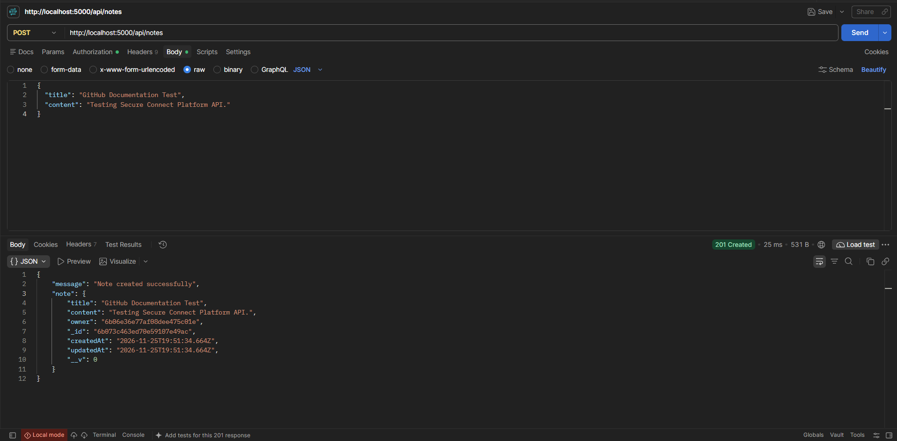
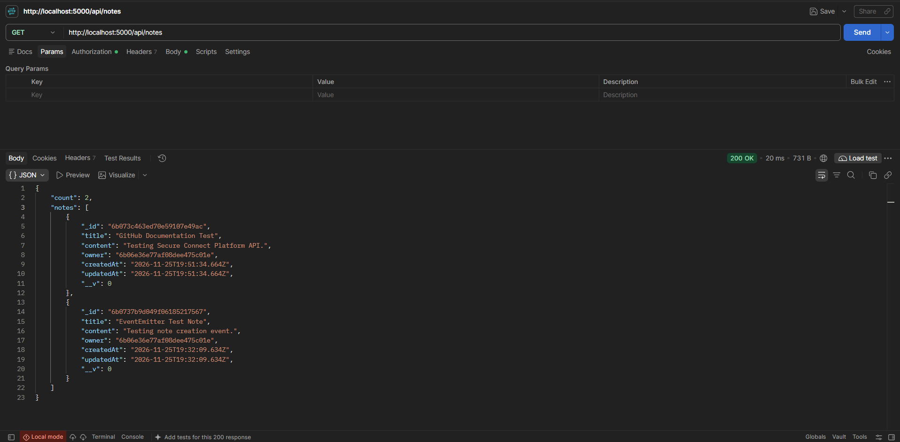
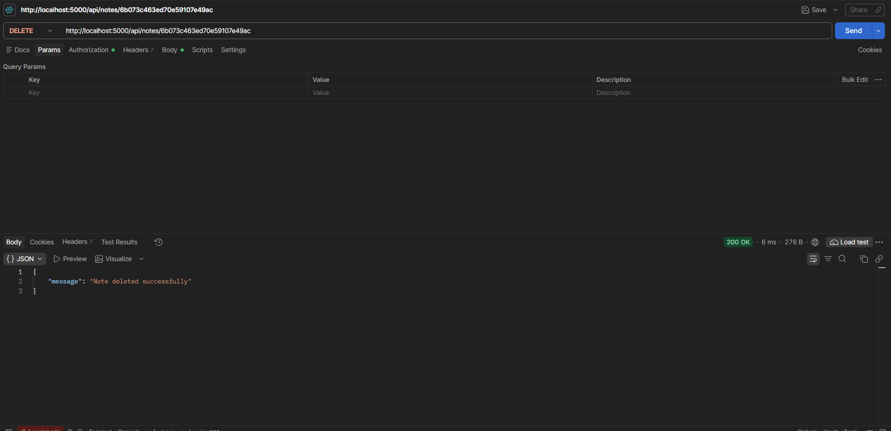
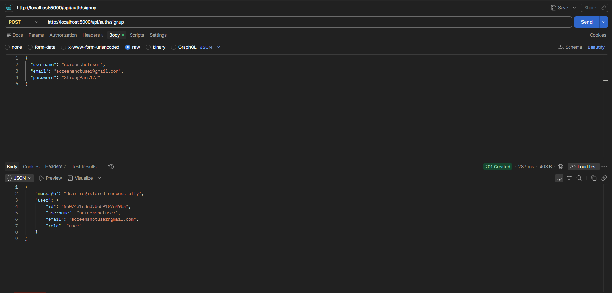
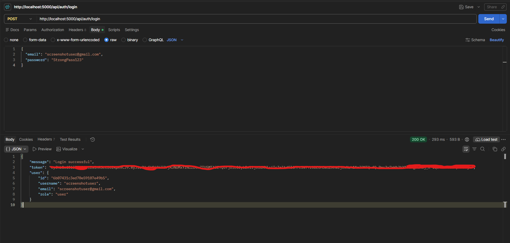
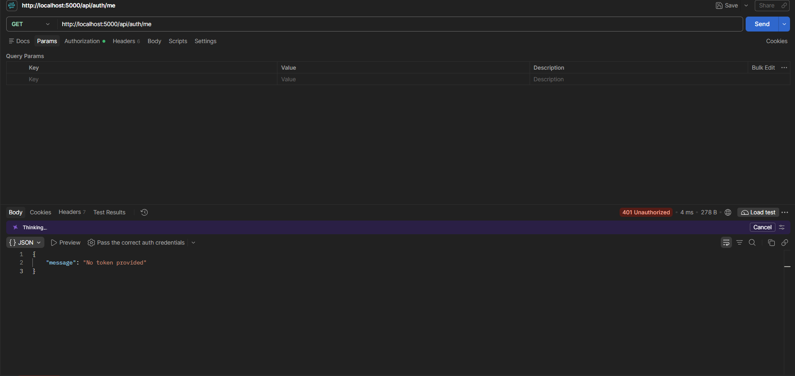
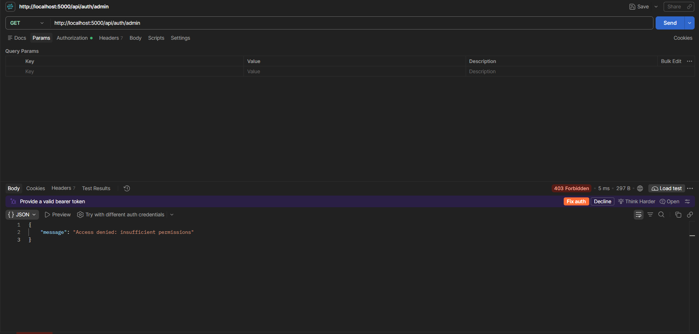
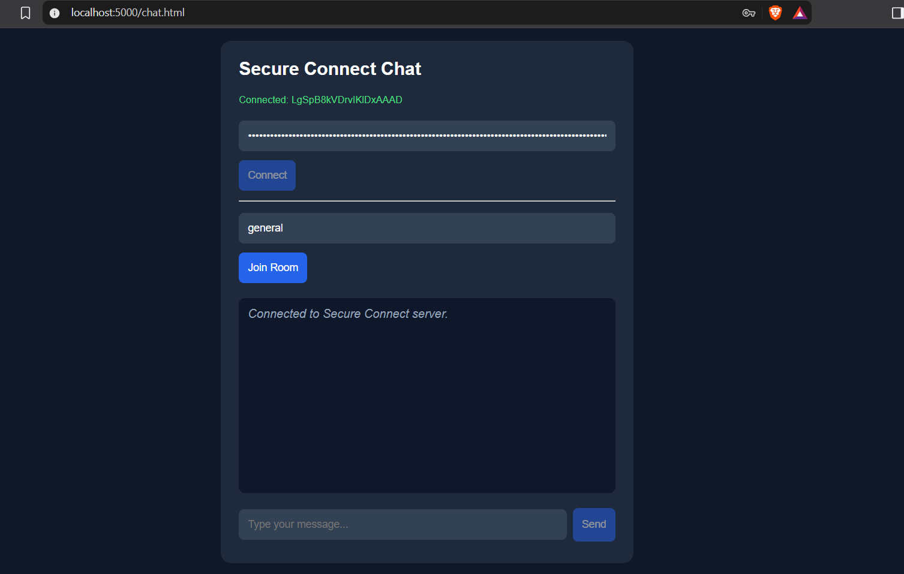
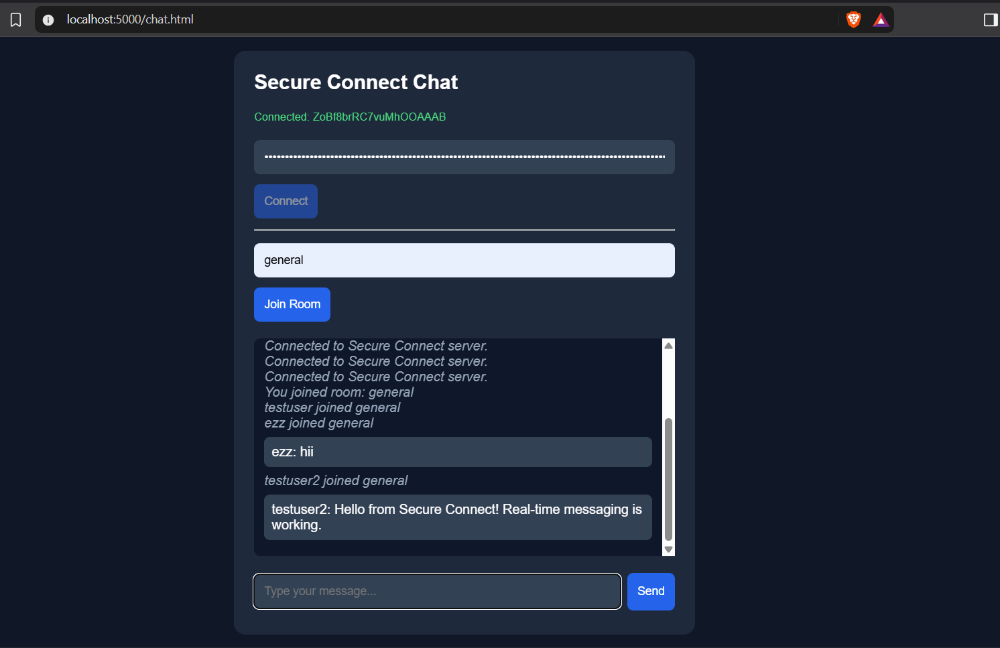

# Secure Connect and Communication Platform

A secure real-time communication platform built using **Node.js, Express.js, MongoDB, JWT Authentication, and Socket.IO**.

This project demonstrates secure user authentication, role-based access control, protected API routes, CRUD operations, event-driven programming, and real-time communication through chat rooms.

## 1. Project Overview

Secure Connect is a backend-focused web application designed to demonstrate secure communication and authentication mechanisms.

The application allows users to register and log in securely, access protected resources, manage their notes, and communicate with other users through real-time chat rooms.

It also implements role-based access control to restrict administrative resources to authorized users.

## 2. Technologies Used

| Technology | Purpose |
|---|---|
| Node.js | Backend runtime environment |
| Express.js | Server-side framework |
| MongoDB | Database |
| Mongoose | MongoDB object modeling |
| JavaScript | Application logic |
| JWT | Authentication |
| bcrypt | Password hashing |
| Socket.IO | Real-time communication |
| Postman | API testing |
| HTML & CSS | Chat interface |
| dotenv | Environment configuration |

## 3. Key Features

### User Authentication
- User registration and login.
- Password hashing using bcrypt.
- JWT-based authentication.
- Secure token-based access.

### Authorization
- Protected API routes.
- Role-Based Access Control (RBAC).
- Separate user and admin permissions.
- Unauthorized access restriction.

### Notes Management
- Create notes.
- Retrieve notes.
- Update existing notes.
- Delete notes.
- Restrict notes access to their respective owners.

### Real-Time Communication
- Socket.IO integration.
- JWT authentication for socket connections.
- Real-time messaging.
- Multiple chat rooms.
- Join and leave room notifications.
- Live message broadcasting.

### Event-Driven Programming
- EventEmitter implementation.
- Custom event handling.
- Event-driven execution.

## 4. Project Structure

```text
secure-connect-platform/
│
├── config/
│   └── db.js
│
├── middleware/
│   └── auth.js
│
├── models/
│   ├── User.js
│   └── Note.js
│
├── routes/
│   ├── auth.js
│   └── notes.js
│
├── socket/
│   └── chat.js
│
├── utils/
│   └── eventBus.js
│
├── public/
│   └── chat.html
│
├── screenshots/
│   ├── 01-event-emitter.png
│   ├── 02-postman-create-note.png
│   ├── 03-postman-get-notes.png
│   ├── 04-postman-update-note.png
│   ├── 05-delete-note.png
│   ├── 06-signup.png
│   ├── 07-login.png
│   ├── 08-protected-no-token.png
│   ├── 09-admin-forbidden.png
│   ├── 10-chat-connection.png
│   └── 11-socket-chat.png
│
├── server.js
├── package.json
├── .env.example
├── .gitignore
└── README.md
```

## 5. Installation and Setup

### Prerequisites

- Node.js installed.
- MongoDB Community Server installed and running.
- Postman for API testing.
- Git installed.

### Step 1: Clone the Repository

```bash
git clone <your-repository-url>
```

### Step 2: Navigate to the Project

```bash
cd secure-connect-platform
```

### Step 3: Install Dependencies

```bash
npm install
```

### Step 4: Configure Environment Variables

Create a `.env` file using `.env.example` as a reference.

Configure the required MongoDB connection, JWT secret, and server settings.

**Note:** Never upload your actual `.env` file or JWT secrets to GitHub.

### Step 5: Start the Server

For normal execution:

```bash
npm start
```

For development:

```bash
npm run dev
```

The server runs locally on port 5000.

## 6. API Testing Using Postman

The backend APIs were tested using Postman to verify authentication, authorization, and CRUD functionality.

### Authentication APIs

| Method | Endpoint | Description |
|---|---|---|
| POST | `/api/auth/signup` | Register a new user |
| POST | `/api/auth/login` | Authenticate an existing user |
| GET | `/api/auth/me` | Retrieve authenticated user details |
| GET | `/api/auth/admin` | Access admin-protected resources |

### Notes APIs

The application implements CRUD functionality for notes:

- Create Note
- Get Notes
- Update Note
- Delete Note

Protected routes require a valid JWT token.

## 7. API Testing Screenshots

### Event Emitter Implementation


### Create Note



### Retrieve Notes



### Update Note


### Delete Note



## 8. Authentication and Authorization Testing

### User Registration



### User Login



### Protected Route Without Token



The API correctly rejects requests when a valid authentication token is not provided.

### Role-Based Access Control



The application restricts unauthorized users from accessing admin-only resources.

## 9. Real-Time Chat Using Socket.IO

The application includes a real-time chat system implemented using Socket.IO.

Users can authenticate using their JWT token, connect to the server, join chat rooms, and exchange messages instantly.

### Chat Connection



### Real-Time Messaging



### Socket Events

| Event | Function |
|---|---|
| `chat:join` | Join a specific chat room |
| `chat:message` | Send and receive messages |
| `chat:system` | Display system notifications |

The chat system demonstrates real-time, event-based communication between connected clients.

## 10. Security Considerations

- Passwords are hashed before being stored in MongoDB.
- JWT authentication protects private resources.
- Protected routes require valid authentication.
- Notes are restricted to their respective owners.
- Admin permissions are verified on the server.
- Socket connections use JWT authentication.
- Environment variables are used for sensitive configuration.

## 11. Learning Outcomes

Through this project, the following concepts were implemented and explored:

- Backend development using Node.js and Express.js.
- Database integration using MongoDB and Mongoose.
- User authentication using JWT.
- Password security using bcrypt.
- Role-Based Access Control.
- REST API development and testing.
- CRUD operations.
- Event-driven programming using EventEmitter.
- Real-time communication using Socket.IO.
- Git and GitHub for version control.

## 12. Conclusion

The Secure Connect and Communication Platform demonstrates the implementation of secure backend development practices along with real-time communication functionality.

The project combines authentication, authorization, database management, event-driven programming, and real-time messaging into a single application.

It provides practical experience in developing secure and scalable backend applications using modern JavaScript technologies.

---

## Project Submitted By

**Name:** Sumit Bhati  
**Course:** BCA(AI & DS)  
**Roll Number:** 2501060223

**Project:** Secure Connect and Communication Platform